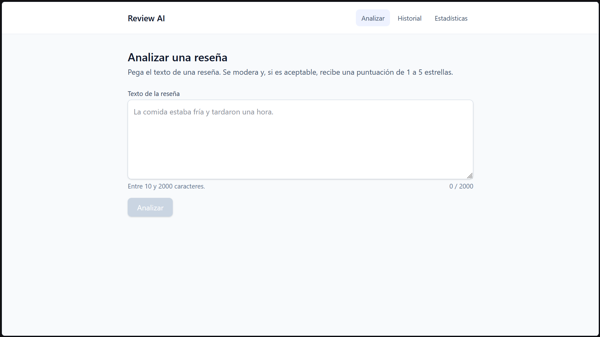
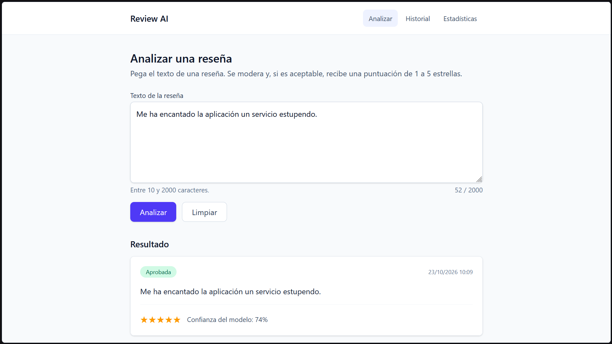
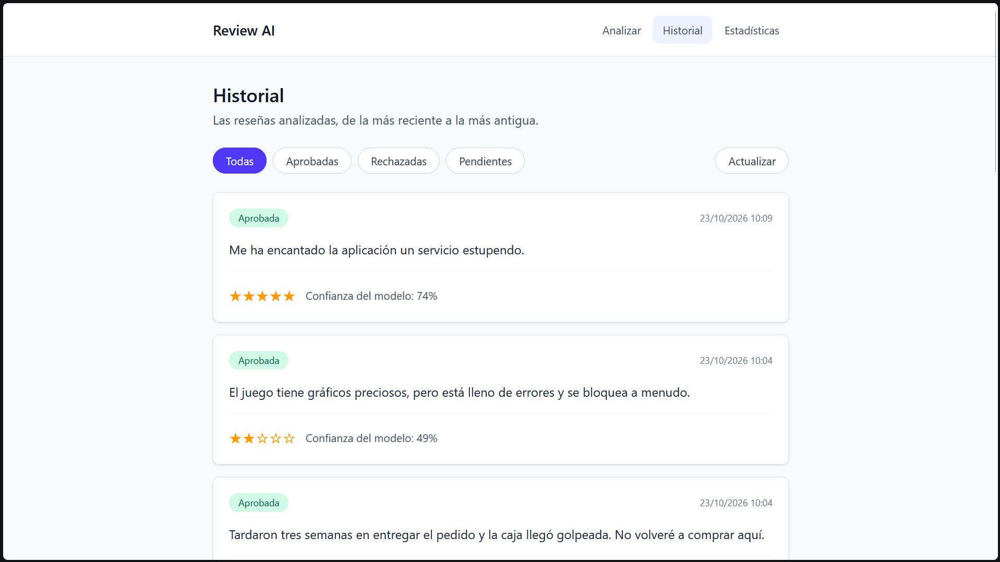
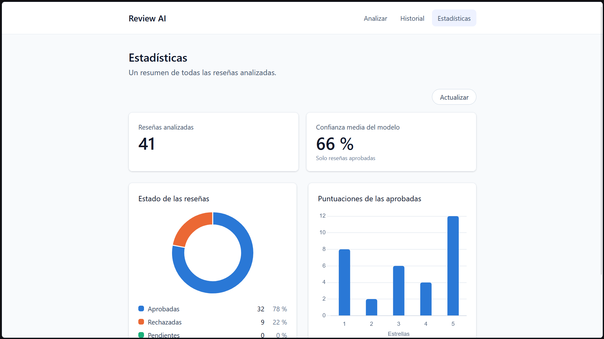

# review-ai-platform

Plataforma de análisis de reseñas con inteligencia artificial. Se le da el texto de una reseña y el sistema la modera automáticamente y le asigna una puntuación de 1 a 5 estrellas. Pensada como herramienta para quien recibe reseñas y quiere analizarlas, no como un portal donde se publican opiniones: por eso una reseña es solo un texto, sin usuarios ni catálogo de productos. Todo funciona en local, sin servicios externos de pago ni cuentas en la nube.

Es un proyecto de portfolio, organizado como monorepo.

## Capturas

| Analizar una reseña | Resultado |
|---|---|
|  |  |
| **Historial** | **Estadísticas** |
|  |  |

## Arquitectura

```
Frontend (Angular)  -->  Backend (Spring Boot + PostgreSQL)  -->  AI service (FastAPI)
```

- El frontend solo habla con el backend.
- El backend guarda las reseñas, gestiona su estado y llama al microservicio de IA.
- El microservicio de IA analiza un texto y devuelve la moderación y la puntuación. No guarda nada.

## Estructura del repositorio

| Carpeta | Contenido |
|---|---|
| `ai-service/` | Microservicio de IA en Python con FastAPI |
| `backend/` | API REST en Spring Boot con PostgreSQL y validación (sin autenticación por ahora) |
| `frontend/` | Aplicación Angular con Tailwind: analizar una reseña, historial con filtro y paginación, y estadísticas con gráficas (Chart.js) |
| `evaluation/` | Dataset etiquetado a mano y notebook que mide la calidad de los modelos ([README](evaluation/README.md)) |
| `scripts/` | Reseñas de demo en CSV y un script que las carga en el backend |
| `docs/api.md` | Contrato JSON entre `ai-service` y `backend` (fuente de verdad) |
| `docs/backend-api.md` | API REST del backend, la que usa el frontend |

## Decisiones de diseño

- **Todo en local.** No se usan APIs de pago ni servicios en la nube.
- **Puntuación.** Modelo preentrenado `nlptown/bert-base-multilingual-uncased-sentiment`: un BERT multilingüe ajustado para clasificar reseñas de 1 a 5 estrellas, que admite varios idiomas, entre ellos el español. Se usa tal cual, sin reentrenar. Se carga una sola vez al importar el módulo, para no pagar el coste de carga en cada petición.
- **Moderación híbrida.** Reglas simples (longitud mínima, enlaces, spam) combinadas con Detoxify `multilingual`, un modelo XLM-RoBERTa (familia BERT/RoBERTa) preentrenado para detectar toxicidad en varios idiomas, con un umbral de toxicidad configurable (0.90 por defecto, elegido en la evaluación). Las reglas son rápidas y explicables; el modelo cubre lo que las reglas no detectan.
- **Reseña marcada, sin puntuación.** Si la moderación marca una reseña, `rating` devuelve `null` y no se ejecuta el modelo de estrellas. Así se evita gastar cómputo en texto que no se va a publicar.
- **Estados de reseña.** Los gestiona Spring: `PENDING` pasa a `APPROVED` o `REJECTED`.
- **Las reseñas rechazadas se guardan.** Sirven para auditar la moderación y, en la fase 4, para medir el modelo y elegir el umbral.
- **Tolerancia a fallos de la IA.** Si el `ai-service` no responde, la reseña se guarda como `PENDING` y un job programado la reintenta, con un máximo de intentos. No se pierde ningún dato por una caída.
- **Esquema versionado con Flyway.** La base de datos se crea con migraciones SQL del repositorio, no con el esquema autogenerado de Hibernate.
- **Sin modelo de dominio extra.** Una reseña es solo texto más su análisis: ni usuarios ni productos. El objetivo del proyecto es la IA y el backend.
- **Versión del modelo.** Cada respuesta incluye `model_version`, para poder comparar modelos durante la evaluación.

## Plan por fases

0. Estructura y contrato
1. Microservicio FastAPI y Dockerfile
2. Backend Spring Boot y PostgreSQL
3. Frontend Angular
4. Evaluación del modelo: MAE, accuracy y matriz de confusión. El umbral de toxicidad se elige con un CSV propio de reseñas etiquetadas.
5. Panel de análisis, tests, Docker Compose y despliegue (con Docker Compose, en local)

Las seis fases están completadas y el proyecto se da por terminado. La CI y Spring Security no se incluyeron y quedan como mejoras futuras, junto con el resto de [Ideas pendientes](#ideas-pendientes).

## Evaluación de los modelos

Se midieron los dos modelos con 200 reseñas en español etiquetadas a mano. El dataset incluye a propósito insultos, amenazas y contenido sexual, para poder medir la moderación. El detalle, con el código y las gráficas, está en [evaluation/](evaluation/README.md).

- **Puntuación.** El 63.6 % de las reseñas recibe la puntuación exacta y el 96.5 % se queda a una estrella como máximo (error medio de 0.42 estrellas). Va bien en 1★ y 5★ y peor en las intermedias.
- **Moderación.** Con el umbral de toxicidad en 0.90, precision 0.93 y recall 0.80. El umbral se subió desde 0.65 para no bloquear reseñas legítimas. El punto débil son las amenazas, que Detoxify casi no detecta en español.

Son resultados con un dataset pequeño, redactado y etiquetado por una sola persona; las limitaciones están explicadas en el README de `evaluation/`.

## Contrato de la API de IA

Resumen del endpoint principal. El detalle completo está en [docs/api.md](docs/api.md).

```
POST /analyze
{ "text": "La comida estaba fría y tardaron una hora." }
```

La respuesta incluye `moderation`, `rating` y `model_version`.

## Cómo ejecutarlo

Hay dos formas de ejecutarlo. En las dos hay que copiar `.env.example` a `.env` y cambiar la contraseña (`DB_PASSWORD`).

### Todo en Docker

Es lo más simple: un solo comando levanta la base de datos, el servicio de IA, el backend y el frontend. Solo hace falta Docker Desktop. Desde la raíz del repo:

```powershell
docker compose up -d --build
```

La primera vez tarda varios minutos, porque se construyen las cuatro imágenes y la del servicio de IA descarga los modelos (más de 1 GB). Las siguientes veces reutilizan la caché y arrancan en segundos. Los servicios esperan unos a otros: el backend no arranca hasta que PostgreSQL y el servicio de IA están sanos, y el frontend espera al backend.

| Servicio | Dirección |
|---|---|
| **Aplicación (frontend)** | http://localhost:4200 |
| Backend | http://localhost:8080 (`/actuator/health`, `/api/reviews`) |
| Servicio de IA | http://localhost:8000 (`/health`) |
| PostgreSQL | `localhost:5432` |

El frontend lo sirve nginx, que además reenvía `/api` al backend: el navegador solo habla con el puerto 4200. El backend y el frontend solo escuchan en `127.0.0.1`, porque la API todavía no tiene autenticación.

```powershell
docker compose ps                  # estado y salud de cada servicio
docker compose logs -f backend     # logs de un servicio
docker compose down                # parar y borrar los contenedores; los datos se conservan
docker compose down -v             # además borra la base de datos
```

Si ya tienes algo en el puerto 4200 u 8080 (por ejemplo `npm start` o `mvnw spring-boot:run`), o lo paras, o cambias los puertos de la aplicación en `.env` con `FRONTEND_PORT` y `BACKEND_PORT`.

### Para desarrollar

Se levantan en Docker solo el servicio de IA y la base de datos, y el backend y el frontend se ejecutan en tu máquina, con recarga automática. Requisitos: Docker Desktop, Java 21 y Node.

```powershell
docker compose up -d --build postgres ai-service
```

Después, el backend desde `backend/` (los comandos y la configuración de Java están en su [README](backend/README.md)):

```powershell
.\mvnw.cmd spring-boot:run
```

Por último, el frontend desde `frontend/` (más detalles en su [README](frontend/README.md)):

```powershell
npm install   # solo la primera vez
npm start
```

Con `npm start` el frontend reenvía `/api` al backend con un proxy de desarrollo.

### Datos de demo

Con la base de datos vacía, el historial y las estadísticas no enseñan nada. [scripts/demo_reviews.csv](scripts/demo_reviews.csv) tiene 40 reseñas en español, redactadas para este proyecto: 31 normales con puntuaciones variadas y 9 que la moderación debería marcar (insultos, amenazas, enlaces y spam). Están mezcladas, para que las rechazadas no salgan todas juntas.

Con el backend en marcha (en Docker o en local), desde la raíz del repo:

```powershell
python scripts/seed_reviews.py
```

El script solo usa la librería estándar de Python. Envía cada reseña a `POST /api/reviews`, así que pasan por la moderación y el modelo reales, y muestra el estado y las estrellas de cada una. La columna `esperado` del CSV no se envía: sirve para avisar si algún estado no coincide con lo previsto (las amenazas son el punto débil de la moderación). Si el backend no está en el puerto 8080, se indica con `--url`.

El script no comprueba duplicados: si se ejecuta dos veces, quedan 80 reseñas. Para empezar de cero hay que borrar también el volumen de la base de datos (esto elimina todas las reseñas guardadas):

```powershell
docker compose down -v
docker compose up -d
```

### Base de datos con interfaz web

Opcional, para ver y editar la base de datos con pgAdmin (http://localhost:5050):

```powershell
docker compose --profile tools up -d pgadmin
```

## Ideas pendientes

- Carga masiva desde la aplicación: subir un CSV con muchas reseñas y procesarlas por lotes. Hoy solo existe el script de demo.
- Decidir qué muestra la vista pública. Hoy el listado devuelve también las reseñas rechazadas, con su texto.
- Reintento manual de una reseña `PENDING` que agotó sus intentos.
- Spring Security.
- Integración continua (CI) con GitHub Actions: ejecutar los tests de `ai-service`, `backend` y `frontend` y construir las imágenes en cada `push`.
- Los puertos de PostgreSQL y del servicio de IA en `docker-compose.yml` están abiertos a toda la red; convendría limitarlos a `127.0.0.1`, como el backend y el frontend.
- Frontend: tras enviar una reseña que queda `PENDING`, enlazar al historial filtrado por "Pendientes" (para eso el filtro tendría que leerse de la URL). Hoy el historial no se actualiza solo: hay que pulsar "Actualizar".
- Frontend: un texto de solo emojis puede pasar el mínimo de 10 caracteres en JavaScript (UTF-16) y no en Python, y acabar en un 502.
- El límite de 2000 caracteres se cuenta distinto en Java (UTF-16) y en Python (caracteres): un texto con emojis justo en el límite podría dar un 502.

## Configuración y secretos

Las variables de entorno van en un archivo `.env`, que está en `.gitignore` y no se sube al repositorio. Nunca se deben commitear claves ni datos sensibles.
