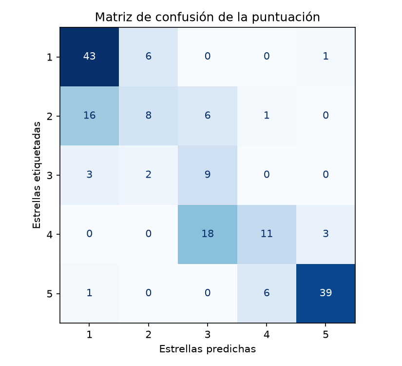
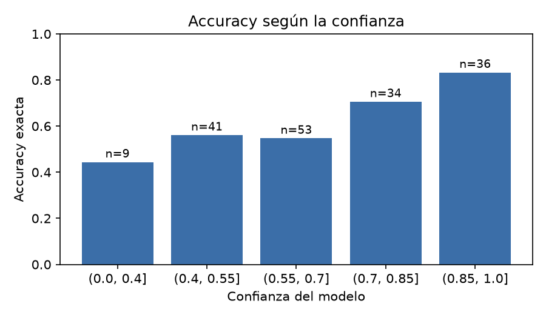
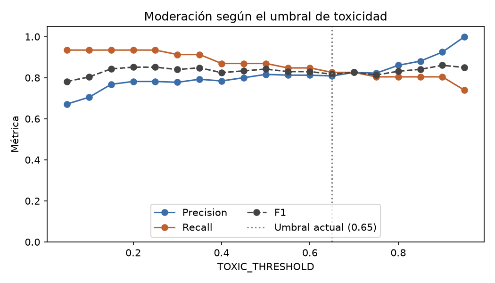

# Evaluación de los modelos

Aquí se mide qué tan bien funcionan las dos piezas del `ai-service` con un conjunto de reseñas propio, etiquetado a mano:

- **Puntuación** (`app/rating.py`): de 1 a 5 estrellas.
- **Moderación** (`app/moderation.py`): reglas más un modelo de toxicidad, con el umbral `TOXIC_THRESHOLD`.

El objetivo es doble: conocer las limitaciones reales de cada modelo y elegir el umbral de toxicidad con datos, en lugar de dejar un valor puesto a ojo. El análisis completo, con el código, está en el notebook [notebooks/evaluation.ipynb](notebooks/evaluation.ipynb), que GitHub muestra con sus tablas y gráficas.

## Modelos evaluados

Se evalúan **dos modelos preentrenados, tal como se publican**. No se ha entrenado ni ajustado ninguno con este dataset.

| Tarea | Modelo | Arquitectura y origen |
|---|---|---|
| Puntuación 1–5 | [`nlptown/bert-base-multilingual-uncased-sentiment`](https://huggingface.co/nlptown/bert-base-multilingual-uncased-sentiment) (Hugging Face, `transformers`) | **BERT** multilingüe (`BertForSequenceClassification`, 12 capas, 768 de dimensión oculta, vocabulario de 105 879 tokens), con una cabeza de clasificación de 5 clases. Según su ficha, es un `bert-base-multilingual-uncased` ajustado con reseñas de productos en seis idiomas, entre ellos el español. |
| Toxicidad | [Detoxify](https://github.com/unitaryai/detoxify) `multilingual` (checkpoint `multilingual_debiased-0b549669.ckpt`) | **XLM-RoBERTa** (`multilingual_toxic_xlm_r` en el código de la librería), de la familia BERT/RoBERTa y preentrenado en 100 idiomas, entrenado con los datos del Jigsaw Multilingual Toxic Comment. Devuelve siete puntuaciones: `toxicity`, `severe_toxicity`, `obscene`, `identity_attack`, `insult`, `threat` y `sexual_explicit`. |

La moderación completa es **híbrida**: a Detoxify se suman unas **reglas** propias (longitud mínima, enlaces y repeticiones de caracteres), que no son un modelo. El identificador `model_version` que devuelve el servicio (`nlptown-bert-v1`) se refiere al modelo de estrellas.

Versiones de las librerías: `transformers` 5.18.0, `torch` 2.14.1 y `detoxify` 0.5.2.

## Estructura

```
evaluation/
├── data/
│   └── reviews.csv       # 200 reseñas etiquetadas a mano
├── images/               # gráficas que genera el notebook
├── notebooks/
│   └── evaluation.ipynb  # carga de datos, métricas, gráficas y conclusiones
├── requirements.txt
└── README.md
```

## Dataset

`data/reviews.csv` tiene 200 reseñas en español y estas columnas:

| Columna | Descripción |
|---|---|
| `id` | Identificador de la fila |
| `text` | Texto de la reseña |
| `stars` | Puntuación de 1 a 5 asignada a mano. Vacía si la reseña no se puede puntuar con sentido |
| `flagged` | `1` si un moderador la bloquearía, `0` si no |

Las reseñas se redactaron para cubrir casos distintos: opiniones normales de las cinco puntuaciones, críticas muy duras pero legítimas (para medir falsos positivos) e insultos, amenazas, contenido sexual, enlaces y spam. Las etiquetas las puso una sola persona, sin ejecutar antes los modelos, para no sesgarlas. De las 200, 173 tienen `stars` y 46 están marcadas (`flagged = 1`).

### Criterio de etiquetado de `flagged`

`flagged` responde a "¿la política de moderación bloquearía esta reseña?", no a "¿esta persona parece sincera?". Se etiqueta con la norma, no con la lectura individual de cada caso.

Se bloquea (`1`):
- Insultos o faltas de respeto a personas, aunque sean suaves.
- Amenazas.
- Contenido sexual explícito dirigido a alguien o gratuito.
- Enlaces.
- Spam: repeticiones exageradas de letras ("buenooooooo", aunque la intención sea sincera), símbolos repetidos o mensajes que son solo risas ("jajajajaja").

No se bloquea (`0`):
- La crítica dura, aunque sea desagradable ("pésimo servicio, una vergüenza").
- Describir hechos desagradables, incluido el acoso sufrido o el contenido sexual de una película, cuando la reseña los cuenta y no los ejerce.
- Risas dentro de una reseña con contenido real ("jajaja esto es lo máximo").

El archivo se guarda en UTF-8 con BOM. Para leerlo con pandas hay que usar `encoding="utf-8-sig"`.

## Cómo ejecutarlo

Desde la raíz del repositorio, con el mismo entorno de conda que usa `ai-service` (Python 3.12):

```bash
conda activate review-ai
pip install -r evaluation/requirements.txt
cd evaluation/notebooks
jupyter nbconvert --to notebook --execute --inplace evaluation.ipynb
```

Las dependencias incluyen las de `ai-service`, de modo que el notebook importa `app.rating` y `app.moderation` y evalúa exactamente el código que corre en producción, con las mismas versiones. La primera vez se descargan los modelos desde Hugging Face. También se puede abrir el notebook en VS Code o Jupyter y ejecutarlo celda a celda.

## Métricas

- **Puntuación:** MAE, accuracy exacta, accuracy con margen de ±1 estrella, matriz de confusión y relación entre `confidence` y acierto.
- **Moderación:** precision, recall y F1 de `flagged` (la clase positiva es "marcada"), y barrido del umbral entre 0.05 y 0.95 para elegir `TOXIC_THRESHOLD`.

## Resultados

### Puntuación (173 reseñas con estrellas)

| | todas | solo no bloqueadas |
|---|---|---|
| MAE (estrellas) | 0.42 | 0.39 |
| Accuracy exacta | 63.6 % | 63.6 % |
| Accuracy ±1 estrella | 96.5 % | 97.4 % |
| Sesgo (con signo) | −0.18 | −0.23 |

"Solo no bloqueadas" deja fuera las reseñas que la moderación bloquearía, que son las que en producción no llegan al modelo de estrellas.

| Estrellas | Precision | Recall | F1 | Reseñas |
|---|---|---|---|---|
| 1 | 0.68 | 0.86 | 0.76 | 50 |
| 2 | 0.50 | 0.26 | 0.34 | 31 |
| 3 | 0.27 | 0.64 | 0.38 | 14 |
| 4 | 0.61 | 0.34 | 0.44 | 32 |
| 5 | 0.91 | 0.85 | 0.88 | 46 |



- El modelo funciona bien en los extremos (1★ y 5★) y es débil en las puntuaciones intermedias, porque tiende a empujar las opiniones hacia los extremos. La clase 3★ tiene pocos ejemplos y sus cifras son poco fiables.
- Puntúa algo por debajo de lo etiquetado.
- Se fija en palabras sueltas: *"Es una burla que llamen cuatro estrellas a este antro"* recibe 4★ con confianza 0.89.
- La confianza que devuelve es útil: la accuracy va del 44 % (confianza ≤ 0.4) al 83 % (confianza > 0.85).



### Moderación (200 reseñas)

Con el umbral elegido, 0.90, el sistema completo (reglas más Detoxify) consigue:

| Precision | Recall | F1 | Falsos positivos | Falsos negativos |
|---|---|---|---|---|
| 0.93 | 0.80 | 0.86 | 3 | 9 |

Las reglas por sí solas tienen precision 1.00 y recall 0.37: no fallan, pero solo cubren 17 de las 46 reseñas marcadas. El resto de la cobertura, y todos los errores, vienen de Detoxify.

Resultados según el umbral, con las reglas siempre activas:

| `TOXIC_THRESHOLD` | Precision | Recall | F1 | Falsos positivos | Falsos negativos |
|---|---|---|---|---|---|
| 0.20 | 0.78 | 0.94 | 0.85 | 12 | 3 |
| 0.65 (valor anterior) | 0.81 | 0.83 | 0.82 | 9 | 8 |
| 0.80 | 0.86 | 0.80 | 0.83 | 6 | 9 |
| 0.85 | 0.88 | 0.80 | 0.84 | 5 | 9 |
| **0.90 (elegido)** | **0.93** | **0.80** | **0.86** | **3** | **9** |
| 0.95 | 1.00 | 0.74 | 0.85 | 0 | 12 |



**Por qué 0.90.** Se prioriza no bloquear reseñas legítimas. Entre 0.80 y 0.90 el recall no cambia y los falsos positivos bajan de 6 a 3. A 0.95 el recall cae de 37 a 34 aciertos, así que 0.90 queda en la zona estable justo antes de la caída. El valor por defecto se cambió de 0.65 a 0.90 en `moderation.py`, `docker-compose.yml`, `.env.example` y `docs/api.md`.

**Errores que quedan:**
- *Falsos positivos (3):* críticas muy duras con vocabulario fuerte, como "Es una porquería de producto". Detoxify no distingue una crítica contundente de un ataque.
- *Falsos negativos (9):* siete amenazas ("le parto la cara", "sé dónde trabajas"), un comentario sexual dirigido y un insulto. Detoxify les da puntuaciones muy bajas en español. Ningún umbral lo arregla: con 0.05 todavía se escapan 3 y aparecen 21 falsos positivos.

## Limitaciones

- Son 200 reseñas redactadas y cortas (47 a 95 caracteres), no reseñas reales ni textos largos. Los 512 tokens del modelo de estrellas no se ejercitan.
- Una sola persona etiquetó los datos, de modo que los casos ambiguos reflejan su criterio.
- El umbral se eligió con los mismos datos con los que se mide, sin un conjunto de prueba aparte, así que las cifras de moderación son optimistas. La diferencia entre 0.85 y 0.90 es de dos reseñas y no es concluyente.
- Con 200 reseñas el margen de error es considerable, sobre todo en las métricas por clase.

## Mejoras posibles

- Reglas o patrones para amenazas ("te voy a…", "sé dónde…"), que Detoxify casi no detecta.
- Detectar mensajes que son solo risas, que la regla de repetición no cubre.
- Revisar las puntuaciones con confianza baja en lugar de aceptarlas sin más.
- Ampliar el dataset con reseñas reales, un segundo etiquetador y un conjunto de prueba separado.
- Comparar otros modelos de estrellas o de toxicidad. `model_version` permite hacerlo sin cambiar el contrato.
